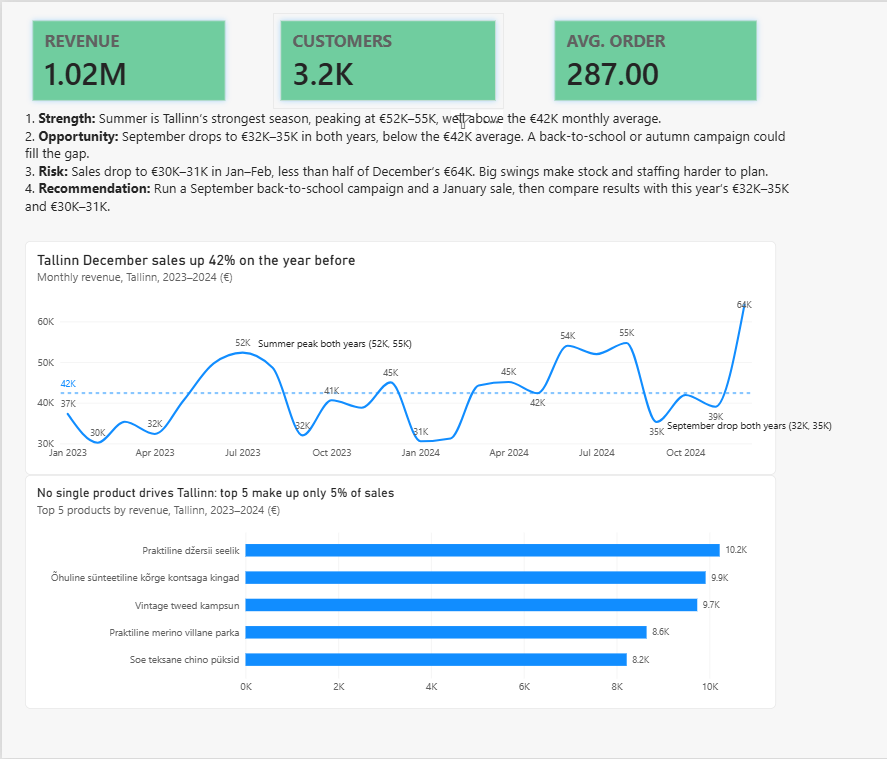

# Week 6: From Dashboard to Data Story (Power BI)

**Live dashboard:** _link coming soon_

## Business context
UrbanStyle is an Estonian fashion retailer with three stores (Tallinn, Tartu, Pärnu) and an online store. The Week 5 dashboard showed the data, but told no story. This week I turned it into an investor-ready dashboard: every chart answers one question, and every page is built for one audience.

## My contribution
Group-work Role A: **Tallinn store dashboard + data story**, completed independently.
I also polished the company-wide view into two pages: **Investors** (growth and risk) and **Operations** (stock).

## Key findings: Tallinn
- Tallinn is the biggest store: **€1.02M, 38% of all sales**.
- **December sales grew 42%** year on year.
- **Summer peaks** (€52K–55K) and **September dips** (€32K–35K) repeat in both years.
- No single product drives sales: the **top 5 products make up only 5%** of revenue.

Full story: [narrative](individual/week6_tallinn_narrative.md) · [executive summary](individual/week6_executive_summary.md)

## How I built the story
- **Titles as conclusions:** "Tallinn December sales up 42%", not "Sum of total_price".
- **Annotations:** an average line (€42K) and two callouts for patterns that repeat every year.
- **Executive summary:** strength, opportunity, risk and recommendation at the top.
- **Data check first:** 2025 had almost no data, which made revenue look like it collapsed. I limited the dashboard to complete years (2023–2024), so every number on the page matches.

## Files
| File | Content |
|---|---|
| `individual/urbanstyle_week5_dashboard_FATIMA.pbix` | Power BI file (polished W5 dashboard) |
| `individual/week6_tallinn_dashboard_screenshot.png` | Tallinn page screenshot |
| `individual/week6_tallinn_narrative.md` | 4-sentence data story |
| `individual/week6_executive_summary.md` | Executive summary |

## Tools
Power BI Desktop · Supabase (PostgreSQL) · GitHub

## Reflection
A chart can be technically correct and still mislead: an incomplete year looked like a business collapse. I learned to check the data before writing the story, and to write every title as a conclusion with a number.

## AI use
I used Claude as a coach to check my calculations and sharpen my chart titles and summary wording. All analysis and the dashboard build were done by me in Power BI.
